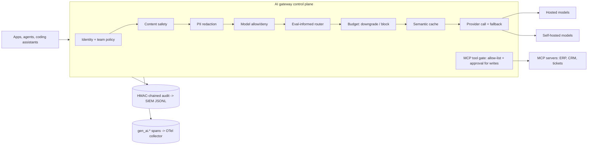

# AI Gateway Control Plane (lab)

**Recruiter summary.** Enterprises let many teams call many models and MCP tools, and lose control of cost, data and access. This lab builds one gateway that every model call and tool call passes through: per-team model allow/deny, eval-informed routing, token budgets with automatic downgrade, a semantic cache, content safety, PII redaction, a tamper-evident audit log and OpenTelemetry-style spans. It runs fully offline with mock providers; every number below comes from a real run of `scripts/run_eval.py` and is **simulated** (synthetic prompts, mock models, illustrative prices).

<!-- BEGIN GENERATED -->

**Tests:** 37 passing (`python scripts/count_tests.py`).

**Results** (SIMULATED: synthetic prompts, mock providers, illustrative prices, 2,000 synthetic requests, 3 teams, seed 42; routing evals on 800 separate prompts):

| Metric | Value |
|---|---|
| Requests | 2000 |
| Served | 1819 |
| Blocked by content safety | 47 |
| Blocked by hard budget | 134 |
| Downgraded by soft budget | 36 |
| Requests with PII redacted | 97 |
| Semantic cache hit rate | 42.4% |
| Accuracy, gateway (synthetic) | 93.5% |
| Accuracy, always-large baseline (synthetic) | 94.0% |
| Illustrative cost, gateway (USD) | 0.1026 |
| Illustrative cost, always-large baseline (USD) | 0.2699 |
| Cost reduction vs baseline | 62.0% |
| Audit chain verified | True |
| OTel-style spans emitted | 2000 |

<!-- END GENERATED -->

> Read the results honestly: the cache hit rate is high because the synthetic workload repeats ~20% of questions by design, and accuracy is drawn from a synthetic skill table per mock model. The point is that the controls work and are measurable, not that these numbers transfer to your traffic.

## Purpose and audience
- **Platform / AI engineers** who must put a governed front door in front of LLMs and MCP tools.
- **Trainees** learning gateway patterns hands-on (see [docs/training.md](docs/training.md)).
- Fictional client used throughout: *Northwind Lattice*, with teams `support`, `finance`, `engineering`.

## Architecture


## How it works
1. **Identity + policy** (`policy.py`): every request names a user and team. Unknown teams are denied. Policies are editable at runtime (`deny_model` / `allow_model` apply on the next call).
2. **Content safety** (`safety.classify`): category phrase filter; blocked requests are denied and audited. (Swap for Azure AI Content Safety, Llama Guard or NeMo Guardrails in production.)
3. **PII redaction** (`safety.redact`): SSN, email, phone and Luhn-validated card numbers are replaced *before* the provider sees the prompt.
4. **Routing** (`router.py`): `run_evals` measures each model per task type on an offline eval set; `Router.choose` picks the cheapest allowed model within a tolerance (default 3 points) of the best.
5. **Budgets** (`budget.py`): above 80% of the monthly token budget the request is downgraded to the team's cheaper model; past 100% it is blocked.
6. **Semantic cache** (`cache.py`): team-scoped; never serves one team's answer to another.
7. **Provider call with fallback** (`gateway.py`): on `ConnectionError` it walks the fallback order, skipping models the team may not use.
8. **Audit + telemetry**: HMAC-chained audit records with pseudonymised users (`verify()` detects tampering); spans carry `gen_ai.request.model`, `gen_ai.usage.input_tokens`, etc.
9. **MCP tool gate** (`Gateway.call_tool`): team allow-list; tools ending `.write` need an `approval_id`.

## Real code and output
```python
g.policies.deny_model("a", "mock-large")
g.chat(Request("u", "a", "vacation days", "mock-large"))
# -> {'status': 'denied', 'reason': 'model_not_allowed:mock-large'}
g.call_tool("u", "a", "ticket.write", {})      # -> {'decision': 'needs_approval'}
redact("My SSN is 123-45-6789")                  # -> ('My SSN is [SSN]', ['SSN'])
```
Routing eval table (measured on the mock models, 200 synthetic prompts per task) is in `results/results.json` under `routing_eval_table`.

## How to run
```bash
python -m venv .venv && . .venv/bin/activate && pip install -r requirements-dev.txt
python scripts/run_eval.py          # simulated run -> results/results.json
python scripts/count_tests.py       # prints TOTAL_TESTS=...
python scripts/render_readme.py     # regenerate the results block above
```
Optional, not run here: `deploy/litellm/config.yaml`, `deploy/kong/kong.yaml`, `deploy/apim/policy.xml` show the same controls on real gateways. Nothing in this repo creates cloud resources.

## Guardrails and security controls
Deny-by-default team policy; content safety before anything else; PII redaction before provider and cache; team-scoped cache; budget hard stop; approval token for write tools; HMAC-pseudonymised, tamper-evident audit; no secrets in repo (gitleaks in CI). Threat model: [docs/threat-model.md](docs/threat-model.md).

## Limitations and known failures
- Content safety is a phrase list: trivially bypassed by paraphrase. It is a placeholder for a real classifier; see the prompt-injection-evals repo.
- Token counting is whitespace-based, not a real tokenizer.
- Semantic cache uses hashed bag-of-words, not embeddings; it can miss paraphrases and, with a low threshold, return wrong answers.
- Budgets are in-memory per process; production needs a shared store (Redis) and atomic counters.
- Mock models and prices are synthetic; routing results do not transfer to real models.

## Built vs planned
| Item | Status |
|---|---|
| Gateway pipeline, router, budgets, cache, safety, PII, audit, spans, MCP gate | Built + tested |
| LiteLLM / Kong / APIM configs | Written, not run |
| Terraform / Bicep for APIM | Planned |
| Real OTel SDK exporter + dashboard | Planned |
| Real embeddings for cache | Planned |

## Docs
[Implementation guide](docs/implementation-guide.md) · [Training](docs/training.md) · [Interview points](docs/interview-points.md) · [Threat model](docs/threat-model.md) · [ADRs](docs/adr/)

## Related repos
Jagadish-permission-aware-rag (retrieval behind this gateway), Jagadish-prompt-injection-evals (measured detector for the safety step), Jagadish-mcp-tool-usage-analytics (analytics over the audit/tool log), Jagadish-coding-assistant-governance (routing coding tools through this gateway), Jagadish-ai-system-design-at-scale (router ladder), Jagadish-token-accounting.

MIT licensed. Lab code; not a product.
